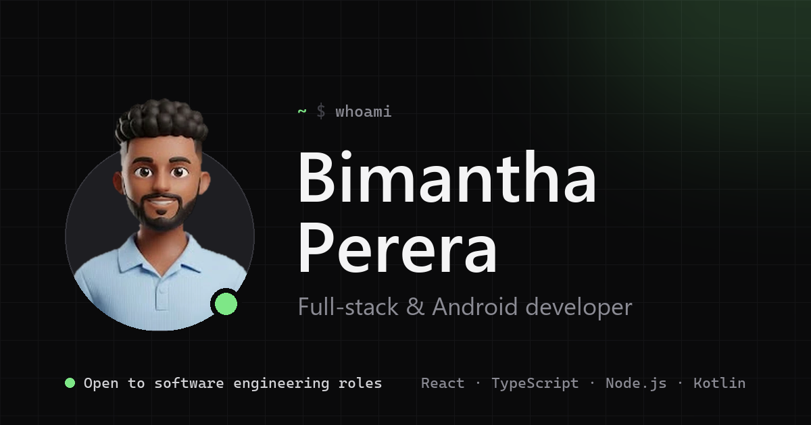

# Bimantha Perera — Developer Portfolio



My personal portfolio: a fast, single-page site with a dark-first, developer-focused design, a full light theme, and motion that respects reduced-motion settings.

**Built with** React 19 · TypeScript · Tailwind CSS v4 · Motion (Framer Motion) · Vite

## Features

- **Hero** with a "pop-out" avatar, a letter-by-letter name reveal and a code card that types itself out
- **About** with a short story, quick facts and how I work
- **Projects** with framed screenshots ([NexCV](https://github.com/Nexcv-dev/AI-CV-Builder) and PickSmart)
- **Case studies** for each project in an accessible modal, with shareable links like `/#projects/nexcv`
- **Download CV** buttons in the navbar, hero and contact section
- **Experience** timeline whose line fills in as you scroll
- **GitHub activity**, live: a contribution graph, streaks and recently pushed repos
- **Skills** grid plus an endless, pausable strip of tech logos in their brand colours
- **Contact** section with one-click copy for the email address
- **Light / dark theme**, switched with a circular reveal that spreads from the toggle (View Transitions API), remembered per visitor, no flash on load
- Sticky navbar that highlights the section you're reading
- Responsive from 375px phones up, keyboard-friendly, with screen-reader text for animated content

## Getting started

Requires Node.js 22 or newer.

```bash
npm install
npm run dev        # http://localhost:5173
```

| Command             | What it does                          |
| ------------------- | ------------------------------------- |
| `npm run dev`       | Start the dev server                  |
| `npm run build`     | Type-check and build to `dist/`       |
| `npm run preview`   | Serve the production build locally    |
| `npm run typecheck` | Type-check only                       |

## Editing content

All text, links and lists live in `src/data/`, so content changes never touch components:

| File            | Contents                                           |
| --------------- | -------------------------------------------------- |
| `profile.ts`    | Name, role, summary, availability, email, socials  |
| `about.ts`      | About section story, facts and principles          |
| `projects.ts`   | Project cards, screenshots, links and case studies |
| `resume.ts`     | CV download (put the PDF in `src/assets/cv/`)      |
| `experience.ts` | Work and education timeline                        |
| `skills.ts`     | Skill groups                                       |
| `techStack.ts`  | Logos in the scrolling strip                       |
| `navigation.ts` | Navbar sections and their order (sets the 01, 02…) |

Colours are design tokens in `src/index.css`: the `@theme` block for dark mode and `html.light` for light mode.

After deploying, set `VITE_SITE_URL` in `.env` to the live address so link previews (LinkedIn, WhatsApp, Slack) can load `og-image.png`.

## Project structure

```
src/
├── components/
│   ├── hero/         Hero, avatar, typing code card, background
│   ├── projects/     Project cards and screenshot frames
│   ├── experience/   Timeline
│   ├── skills/       Skill cards and logo marquee
│   ├── contact/      Contact section and copy-email button
│   ├── layout/       Navbar, mobile menu, theme toggle, footer
│   ├── ui/           Shared pieces: RevealText, FadeIn, SectionHeading
│   └── icons/        Brand icons
├── data/             All site content
├── hooks/            useTypewriter, useTheme, useActiveSection, useScrolled
├── lib/              Animation tokens and theme switching
└── index.css         Tailwind setup and design tokens
```

## Credits

Logos from [Simple Icons](https://simpleicons.org), UI icons from [Lucide](https://lucide.dev), and the [Geist](https://vercel.com/font) typeface.

## Contact

[bimanthaperera55@gmail.com](mailto:bimanthaperera55@gmail.com) · [LinkedIn](https://www.linkedin.com/in/bimantha-perera) · [GitHub](https://github.com/bimanthaperera-lab)
